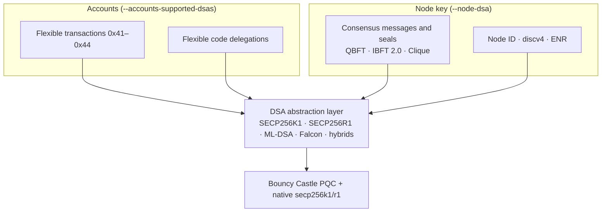

[🏠 Index](README.md) · [⚡ Quick start](00-quick-start.md) · [← Previous: Quick start](00-quick-start.md) · [Next: Architecture →](02-architecture.md)

---

# Motivation and design

## Contents

- [The quantum threat to Ethereum signatures](#the-quantum-threat-to-ethereum-signatures)
- [Choice of algorithms](#choice-of-algorithms)
- [Why hybrids](#why-hybrids)
- [Design principles](#design-principles)
- [What the fork changes, layer by layer](#what-the-fork-changes-layer-by-layer)
- [Non-goals](#non-goals)

## The quantum threat to Ethereum signatures

Everything that is signed in Ethereum uses ECDSA on secp256k1. That includes transactions, EIP-7702 code delegations,
consensus messages and block seals, and peer identities. A large enough quantum computer running **Shor's algorithm**
can compute an ECDSA private key from its public key. Every exposed public key is then compromised. With ECDSA, the
public key of any account that has sent a transaction can be recovered from the transaction's signature.

Data signed today can be forged later, and blockchains are long-lived, so migrating to quantum-resistant signatures has
to start before such machines exist. In 2024, NIST published the first post-quantum signature standards. Migrating a
blockchain client to them raises several engineering problems:

| Problem | Why it matters in Ethereum |
|---|---|
| **No public-key recovery** | Ethereum never sends the sender's key: it is recovered from `(v, r, s)`. Post-quantum schemes cannot do this, so keys must be carried explicitly |
| **Size** | ML-DSA-44 signatures are 37 times larger (2420 B) and keys 20 times larger (1312 B) than ECDSA's. That affects transactions, blocks, consensus messages and UDP discovery packets |
| **Verification cost** | Verifying is no longer "recover and compare". It is a separate operation that must be run, and cached, at every stage |
| **Fixed formats** | Transaction encodings, node IDs, ENR records and `extraData` layouts assume 65-byte signatures and 64-byte keys |
| **Coexistence** | Existing ECDSA accounts and tools must keep working while new accounts adopt post-quantum signatures |

## Choice of algorithms

| Algorithm | Why it was chosen |
|---|---|
| **ML-DSA** (FIPS 204) | The primary NIST standard for post-quantum signatures, based on module lattices. Simple constant-time implementation and fast verification. Three security levels (44, 65, 87) |
| **Falcon-512** (FN-DSA) | Selected by NIST for its compactness: about 660-byte signatures and 896-byte keys, the smallest lattice-based option. Signing is more complex (floating-point Gaussian sampling) |
| **SECP256K1** | The Ethereum default, kept for compatibility and as the classical half of hybrids |
| **SECP256R1** (P-256) | Supported by hardware security modules, secure enclaves and passkeys. Available for networks with `ecCurve: secp256r1` |

## Why hybrids

Post-quantum schemes are young. Implementation flaws and new cryptanalysis are still possible, as the break of the NIST
candidate Rainbow in 2022 showed. A **hybrid** signature is valid only if both an ECDSA signature and a post-quantum
signature verify, so it is at least as strong as the stronger of the two. The fork uses **Strong Nesting
Concatenation**: the post-quantum half signs the message together with the ECDSA signature, which binds the two halves
(see [Hybrid signatures](03-cryptography/hybrid-signatures.md)).

Hybrids also solve practical problems:

- The ECDSA half still supports **public-key recovery**, so only the post-quantum half of the key has to be carried.
- The ECDSA half supplies the elliptic-curve key that the **RLPx handshake** (ECDH) needs.

## Design principles

1. **DSA-agnostic core.** Signing, verification, key handling and address derivation go through one abstraction
   (`DigitalSignatureAlgorithm`). Adding an algorithm means adding a parameter set and an implementation, not changing
   the protocol code.
2. **Self-describing signatures.** Every flexible payload names its algorithm with a 2-byte identifier that the
   signature covers. Nodes never guess an algorithm, and an attacker cannot substitute one.
3. **Carry only what cannot be recovered.** Public keys travel only for non-recoverable algorithms, and for hybrids only
   the post-quantum half travels. This keeps payloads as small as possible.
4. **Backward compatibility by default.** With ECDSA, every encoding (transactions, messages, seals, enodes, ENRs) is
   byte-identical to upstream Besu. Standard transaction types are unchanged.
5. **Policy at the node.** Operators choose which DSAs accounts may use (`--accounts-supported-dsas`) independently of
   the DSA of the node's own key (`--node-dsa`).
6. **Verify everywhere, pay once.** Signatures are verified at pool admission and again during block processing, and
   successful results are cached so that each transaction is verified once per node.

## What the fork changes, layer by layer

## Non-goals

- **Post-quantum key exchange.** RLPx still encrypts with classical ECDH. Only authentication is made post-quantum.
- **Migration of existing accounts.** An ECDSA account cannot be converted into a post-quantum account. Users move funds
  to a new hybrid or post-quantum address.
- **Mainnet compatibility for post-quantum features.** Flexible transactions are not part of any Ethereum Improvement
  Proposal. They are intended for permissioned and consortium networks.
- **Gas pricing of verification.** Verification is not charged in gas yet. The
  [microbenchmark](12-metrics-and-performance.md#dsa-microbenchmark-verification-cost-in-gas) provides data for a future
  decision.

---

[🏠 Index](README.md) · [⚡ Quick start](00-quick-start.md) · [← Previous: Quick start](00-quick-start.md) · [Next: Architecture →](02-architecture.md)
