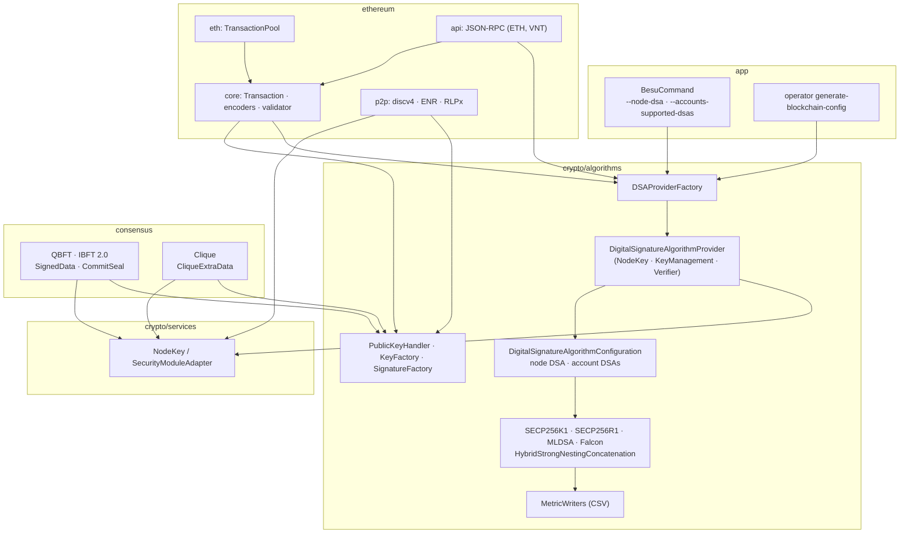
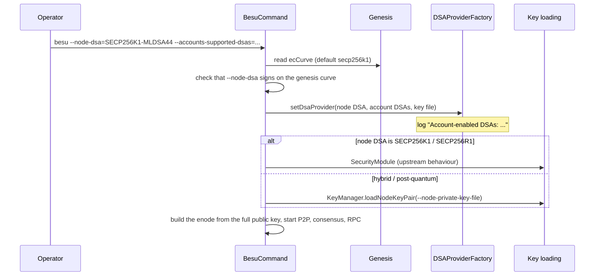
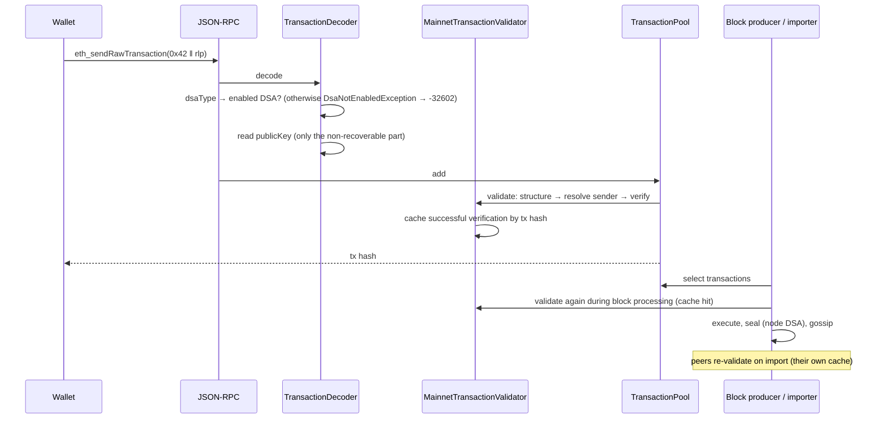
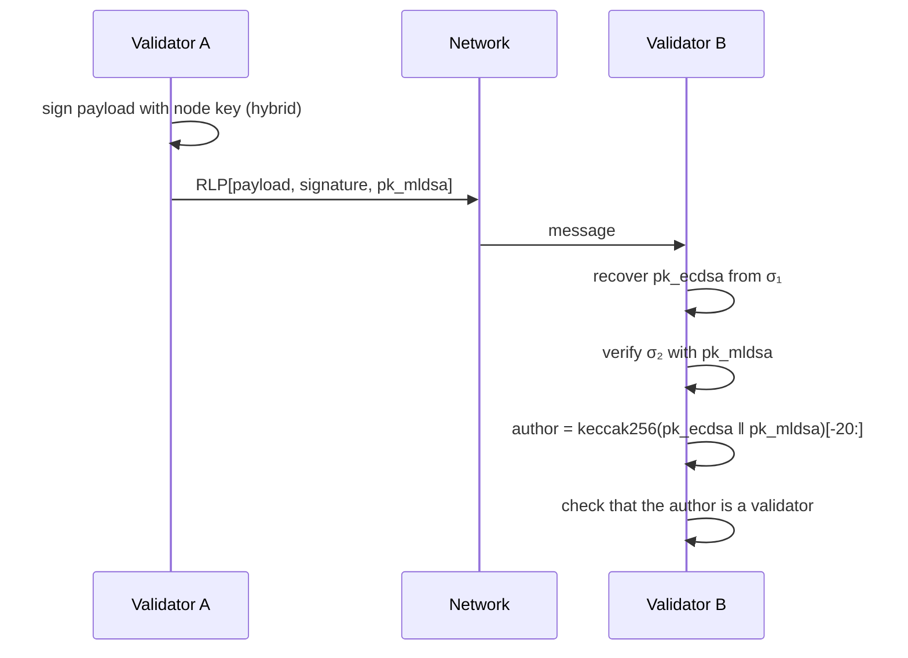

[🏠 Index](README.md) · [⚡ Quick start](00-quick-start.md) · [← Previous: Motivation and design](01-motivation-and-design.md) · [Next: Cryptography →](03-cryptography/README.md)

---

# Architecture

## Contents

- [Module map](#module-map)
- [Component diagram](#component-diagram)
- [Node start-up](#node-start-up)
- [Transaction life cycle](#transaction-life-cycle)
- [Consensus message flow](#consensus-message-flow)
- [Main classes by module](#main-classes-by-module)

## Module map

The fork keeps Besu's module structure. These are the modules it changes:

| Module | Main changes |
|---|---|
| `crypto/algorithms` | The DSA abstraction, ML-DSA, Falcon, hybrids, key factories, providers, signature metrics, microbenchmark |
| `crypto/services` | `NodeKey` and `SecurityModuleAdapter` work with any DSA |
| `datatypes` | `TransactionType` flexible types, `CodeDelegationType`, `Address.extract(PublicKey)` |
| `ethereum/core` | Flexible transaction encoders and decoders, `Transaction` (dsaType, publicKey, sender resolution), `CodeDelegation`, `PublicKeyEncoder` / `PublicKeyDecoder`, `MainnetTransactionValidator`, `MainnetProtocolSpecs` (Prague) |
| `ethereum/eth` | Transaction pool memory accounting for large signatures |
| `ethereum/api` | `VNT` namespace, `vnt_getAccountsSupportedDSAs`, transaction and delegation result objects |
| `ethereum/p2p` | Node IDs of any length, discv4 packets with partial keys, `vnt` node records, ECDHE with the ECDSA half |
| `consensus/common`, `qbft`, `qbft-core`, `ibft`, `clique` | Signed messages carrying keys, commit seals with keys, Clique key-carrying `extraData`, integration tests per DSA |
| `app` | `--node-dsa`, `--accounts-supported-dsas`, DSA provider start-up, `operator generate-blockchain-config --node-dsa` |
| `settings.gradle`, `platform` | Source dependency on the forked discovery library, Bouncy Castle |

## Component diagram

## Node start-up

## Transaction life cycle

## Consensus message flow

## Main classes by module

| Concern | Classes |
|---|---|
| Algorithm registry | `DSAParametersSet`, `SupportedAlgorithms` |
| Algorithms | `SECP256K1`, `SECP256R1`, `MLDSA`, `Falcon`, `HybridStrongNestingConcatenation` |
| Providers | `DSAProviderFactory`, `DigitalSignatureAlgorithmProvider`, `DigitalSignatureAlgorithmConfiguration` |
| Keys | `KeyFactory`, `KeyManager`, `KeyExtractor`, `CompositePublicKey`, `PublicKeyHandler` |
| Signatures | `Signature`, `SignatureFactory`, `CompositeSignature`, `MLDSASignature`, `FalconSignature`, `SignatureValidationContext` |
| Transactions | `TransactionType`, `Transaction`, `Flexible*TransactionEncoder` / `Decoder`, `PublicKeyEncoder` / `Decoder`, `CodeDelegation`, `MainnetTransactionValidator` |
| Consensus | `SignedData`, `CommitSeal`, `BftExtraDataCodec`, `CliqueExtraData`, `CliqueBlockHashing` |
| P2P | `EnodeURLImpl`, `Packet`, `PacketFactory`, `NodeRecordManager`, `EnrSignatureValidator` |
| RPC | `RpcApis.VNT`, `VntGetAccountsSupportedDSAs`, `TransactionCompleteResult`, `TransactionPendingResult`, `CodeDelegationResult` |
| CLI | `BesuCommand`, `NodeDsaCurve`, `DSAParametersSetConverter`, `GenerateBlockchainConfig` |

---

[🏠 Index](README.md) · [⚡ Quick start](00-quick-start.md) · [← Previous: Motivation and design](01-motivation-and-design.md) · [Next: Cryptography →](03-cryptography/README.md)
