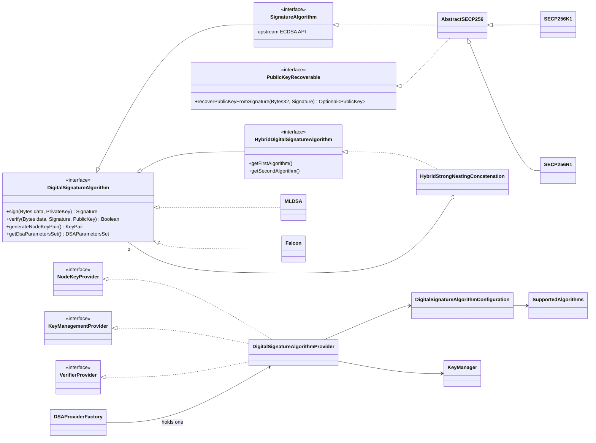

[🏠 Index](../README.md) · [⚡ Quick start](../00-quick-start.md) · [← Previous: Architecture](../02-architecture.md) · [Next: Algorithms →](algorithms.md)

---

# Cryptography: the DSA abstraction layer

Upstream Besu is written around ECDSA. Signatures are `SECPSignature (r, s, recId)`, keys are `SECPPublicKey`, and the
signer is always found by public-key recovery. The fork introduces an abstraction in which any **digital signature
algorithm (DSA)** can sign and verify, whether or not it can recover public keys. Most of it lives in the
`crypto/algorithms` module, package `org.hyperledger.besu.crypto`.

**Pages in this section**

1. This overview: interfaces, providers and configuration
2. [Algorithms](algorithms.md): the registry of supported algorithms, identifiers and sizes
3. [Hybrid signatures](hybrid-signatures.md): how ECDSA and a post-quantum algorithm are combined
4. [Key management](key-management.md): node keys, file formats, public-key encoding, key agreement

## Contents

- [Class diagram](#class-diagram)
- [Core interfaces](#core-interfaces)
- [Providers and the process-wide DSA provider](#providers-and-the-process-wide-dsa-provider)
- [Configuration: node DSA and account DSAs](#configuration-node-dsa-and-account-dsas)
- [Signatures](#signatures)
- [Resolving the signer's public key](#resolving-the-signers-public-key)
- [Addresses](#addresses)

## Class diagram



## Core interfaces

| Type | Role |
|---|---|
| `DigitalSignatureAlgorithm` | The root abstraction: `sign`, `verify`, `generateNodeKeyPair`, `getDsaParametersSet`. Keys are JCA `PrivateKey` / `PublicKey`. |
| `PublicKeyRecoverable` | A mix-in for algorithms that can recover the signer's key from a signature (ECDSA). The rest of the code tests for it with `instanceof` to decide whether a public key must travel with a signature. |
| `HybridDigitalSignatureAlgorithm` | A DSA made of two DSAs. The only implementation is `HybridStrongNestingConcatenation`. |
| `SignatureAlgorithm` | The upstream ECDSA interface. It now extends `DigitalSignatureAlgorithm`, so `SECP256K1` and `SECP256R1` are DSAs too, and all upstream ECDSA code keeps compiling. |
| `SECPCurves` | Returns the algorithm of a given curve, so that a key or signature is handled on its own curve rather than on the process-wide default curve. |
| `SignatureValidationContext` | Options for structural signature checks. Today it has one flag, `disallowMalleability`. |

## Providers and the process-wide DSA provider

`DigitalSignatureAlgorithmProvider` is the single object through which the node signs, verifies and manages keys. It
implements three interfaces, each used by a different part of the code:

| Interface | Used for | Main methods |
|---|---|---|
| `NodeKeyProvider` | signing with the **node's** key (consensus, P2P), wrapped by `cryptoservices.NodeKey` | `sign(Bytes32)`, `getPublicKey()`, `calculateECDHKeyAgreement(PublicKey)` |
| `KeyManagementProvider` | generating and loading node keys | `generateKeyPair(DSAParametersSet)`, `loadNodeKeyPair()` |
| `VerifierProvider` | finding the algorithm of a received payload and verifying it | `getAccountEnabledDSAById(Short)`, `getActiveDSA()`, `verifySignature(...)`, `getAccountsSupportedDSANames()` |

`DSAProviderFactory` holds one provider for the whole process. `BesuCommand` sets it up at start-up from
`--node-dsa`, `--accounts-supported-dsas` and the node key file. When no provider is configured (in some tests and
tools), the factory falls back to upstream's `SignatureAlgorithmFactory`, which is ECDSA on the genesis curve.

For classical node keys, `BesuCommand` keeps using upstream's `SecurityModule` plugin interface, through a
`SecurityModuleAdapter` that implements `NodeKeyProvider`. See [Key management](key-management.md#node-keys-at-start-up).

## Configuration: node DSA and account DSAs

The fork distinguishes two independent choices:

| Concept | Option | Scope | Implementation |
|---|---|---|---|
| **Node DSA** | `--node-dsa` | the node's own key: consensus messages, block seals, P2P identity | `DigitalSignatureAlgorithmConfiguration.nodeActiveDSA` |
| **Account DSAs** | `--accounts-supported-dsas` | which DSAs transactions and code delegations may use | `DigitalSignatureAlgorithmConfiguration.accountsEnabledDSAs` |

- `SupportedAlgorithms` maps every DSA name to a factory.
- The account DSAs are built **once** at start-up into an immutable map keyed by DSA identifier. The algorithm
  instances are stateless and shared by all threads, because building an instance (for example registering the
  Bouncy Castle PQC provider) is expensive.
- A lookup for a DSA that is not enabled throws `DsaNotEnabledException`, with the message
  `DSA type <NAME> (0x<id>) is not enabled for accounts on this node`.

See [Configuration](../10-configuration.md) for the option reference.

## Signatures

| Type | Encoding (`encodedBytes()`) | `isValid(context)` |
|---|---|---|
| `SECPSignature` | `r (32) ‖ s (32) ‖ recId (1)`. It also records its curve | low-`s` check on its own curve when malleability is disallowed |
| `MLDSASignature` | raw FIPS 204 signature | non-empty |
| `FalconSignature` | raw Falcon signature, variable length | non-empty and at most 752 bytes (Falcon-512) |
| `CompositeSignature` | `first ‖ second` | both halves valid |

`SignatureFactory.createSignatureFromBytes(bytes, dsaParametersSet)` turns bytes received from the network into a typed
signature, and splits hybrid signatures (see [Hybrid signatures](hybrid-signatures.md#signature-layout)).

## Resolving the signer's public key

Every place that used to recover the signer now calls `PublicKeyHandler.resolvePublicKey(dsa, signature,
providedPublicKey, hash, context)`:

| Algorithm | Result |
|---|---|
| Recoverable (ECDSA) | recovered from the signature. A provided key is never trusted for this part |
| Non-recoverable (ML-DSA, Falcon) | the provided public key. It is an error if none was provided |
| Hybrid | `CompositePublicKey(recovered ECDSA half, provided post-quantum half)` |

`PublicKeyHandler.providedPart(dsa, publicKey)` does the reverse: it returns the part of a key that must be **carried**
with a signed payload. Transactions, code delegations, consensus messages and seals all apply this same rule.

> Resolving a key does **not** verify the signature. For non-recoverable algorithms, callers must verify the signature
> against the resolved key; see [Security considerations](../08-security.md#hybrid-verification-and-key-binding).

## Addresses

```java
Address.extract(PublicKey publicKey) = last 20 bytes of keccak256(publicKey.getEncoded())
```

This is the upstream rule, applied to any key encoding: 64 bytes for ECDSA, 1312 bytes for ML-DSA-44, 896 bytes for
Falcon-512, and the full concatenation for a hybrid. `Address.signatureToAddress(dsa, signature, providedKey, hash,
context)` resolves the key and derives the address. It replaces upstream's ECDSA-only `Util.signatureToAddress`.

---

[🏠 Index](../README.md) · [⚡ Quick start](../00-quick-start.md) · [← Previous: Architecture](../02-architecture.md) · [Next: Algorithms →](algorithms.md)
