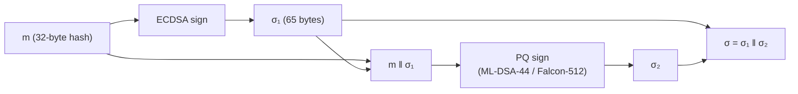
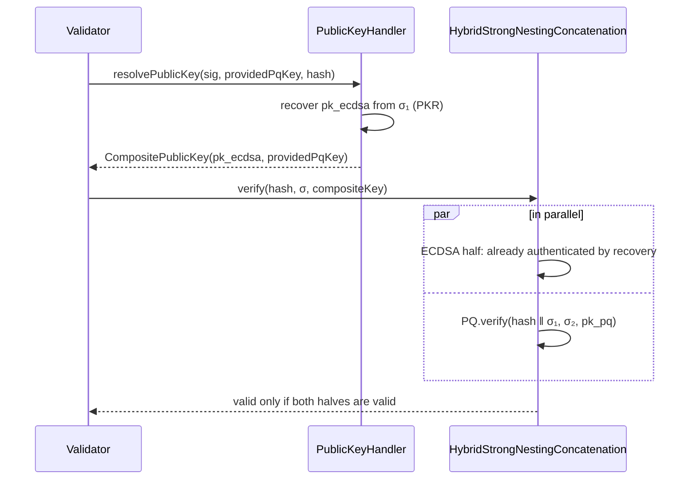

[🏠 Index](../README.md) · [⚡ Quick start](../00-quick-start.md) · [↑ Cryptography](README.md) · [← Previous: Algorithms](algorithms.md) · [Next: Key management →](key-management.md)

---

# Hybrid signatures

A hybrid signature combines a classical signature (ECDSA secp256k1) and a post-quantum signature (ML-DSA-44 or
Falcon-512). It stays secure as long as **at least one** of the two algorithms is unbroken:

- ECDSA protects against a flaw in the comparatively young post-quantum scheme or its implementation.
- The post-quantum half protects against a quantum computer that breaks ECDSA.

Hybrids are also the bridge for migration. The ECDSA half keeps public-key recovery and elliptic-curve key agreement
(RLPx) working.

## Contents

- [Strong Nesting Concatenation](#strong-nesting-concatenation)
- [Key layout](#key-layout)
- [Signature layout](#signature-layout)
- [Verification](#verification)
- [Public key on the wire](#public-key-on-the-wire)
- [Hybrid addresses](#hybrid-addresses)

## Strong Nesting Concatenation

Implemented by `crypto/algorithms/.../algorithms/hybrid/HybridStrongNestingConcatenation.java`.



```java
Signature first  = ecdsa.sign(data, sk.getFirstKey());
Signature second = pq.sign(Bytes.concatenate(data, first.encodedBytes()), sk.getSecondKey());
return new CompositeSignature(first, second);
```

The post-quantum half signs the message **and** the ECDSA signature (*strong nesting*). An attacker therefore cannot
remove or replace the classical half and keep a valid post-quantum half. The two signatures are bound together, unlike a
simple concatenation of two independent signatures.

The first algorithm is always the classical one. It has a fixed length, so the variable-length Falcon signature can come
last and be found by its offset.

## Key layout

| Hybrid | Private key | Public key |
|---|---|---|
| `SECP256K1-MLDSA44` | `sk_ecdsa (32) ‖ sk_mldsa (2560)` = 2592 B | `pk_ecdsa (64) ‖ pk_mldsa (1312)` = 1376 B |
| `SECP256K1-FALCON512` | `sk_ecdsa (32) ‖ sk_falcon (2176)` = 2208 B | `pk_ecdsa (64) ‖ pk_falcon (896)` = 960 B |

- The ECDSA public key is uncompressed `x ‖ y`, without the `0x04` prefix.
- In memory, the keys are `CompositePrivateKey` and `CompositePublicKey`. Their encoding is the concatenation
  (format `"concatenated"`, algorithm name such as `"SECP256K1-MLDSA44"`).

## Signature layout

| Hybrid | Bytes `[0, 65)` | Bytes `[65, end)` | Total |
|---|---|---|---|
| `SECP256K1-MLDSA44` | ECDSA `r ‖ s ‖ recId` | ML-DSA-44 | exactly 2485 |
| `SECP256K1-FALCON512` | ECDSA `r ‖ s ‖ recId` | Falcon-512 | 66 to 817 |

`SignatureFactory` rejects a hybrid signature with any other length. The total length of a Falcon hybrid comes from the
enclosing RLP item.

## Verification



- The post-quantum half is verified over `hash ‖ σ₁`.
- The ECDSA half is a recoverable algorithm, so it is authenticated by **recovering** its public key from `σ₁`. A
  successful recovery yields the key that produced the signature, and that key becomes part of the composite key and
  the address. `verify()` therefore does not re-run ECDSA verification for a recoverable half.
- When neither half is recoverable, both halves are verified, in parallel on the common fork-join pool.

> **Important for integrators:** `HybridStrongNestingConcatenation.verify()` on its own does not check the ECDSA half.
> Security depends on the caller using a key whose ECDSA half was **recovered** from the signature (as
> `PublicKeyHandler` does), never a caller-supplied ECDSA key. See
> [Security considerations](../08-security.md#hybrid-verification-and-key-binding).

## Public key on the wire

Only the half that cannot be recovered travels with a signed payload (see
[Transactions → The public key field](../04-transactions.md#the-public-key-field)):

| Hybrid | Carried key |
|---|---|
| `SECP256K1-MLDSA44` | `pk_mldsa`, 1312 bytes |
| `SECP256K1-FALCON512` | `pk_falcon`, 896 bytes |

Carrying the full composite key in a transaction is rejected. In other contexts (`KeyFactory.createPublicKey`), both the
full and the partial forms are accepted.

## Hybrid addresses

A hybrid account's address is `keccak256(pk_ecdsa ‖ pk_pq)[12:]`. It commits to **both** keys, so:

- the hybrid account and the plain ECDSA account derived from the same ECDSA key are **different accounts**;
- an attacker who forges only one half (for example a quantum attacker who recovers `sk_ecdsa`) cannot spend from the
  hybrid account.

Tests: `AddressFromHybridPublicKeyTest` (`datatypes`).

---

[🏠 Index](../README.md) · [⚡ Quick start](../00-quick-start.md) · [↑ Cryptography](README.md) · [← Previous: Algorithms](algorithms.md) · [Next: Key management →](key-management.md)
