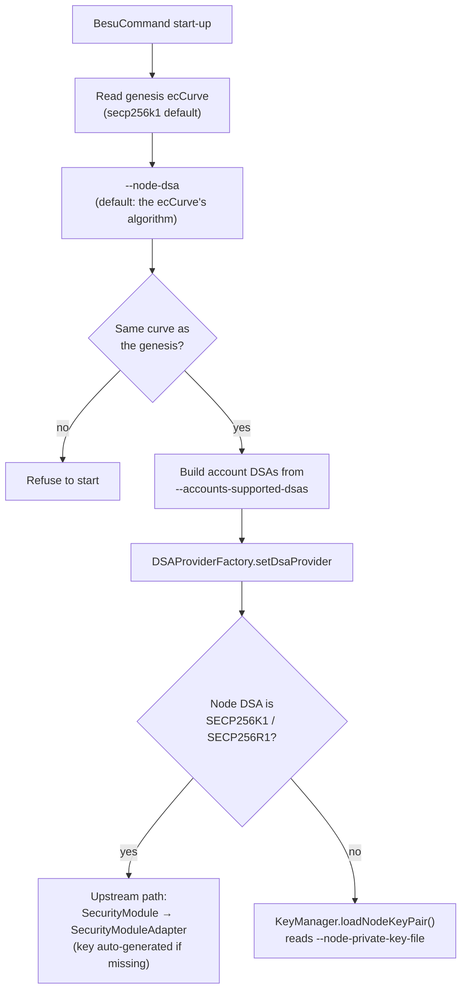

[🏠 Index](../README.md) · [⚡ Quick start](../00-quick-start.md) · [↑ Cryptography](README.md) · [← Previous: Hybrid signatures](hybrid-signatures.md) · [Next: Transactions →](../04-transactions.md)

---

# Key management

## Contents

- [Node keys at start-up](#node-keys-at-start-up)
- [Node key file format](#node-key-file-format)
- [Generating node keys](#generating-node-keys)
- [Key classes](#key-classes)
- [Public-key encoding rules](#public-key-encoding-rules)
- [Key agreement (ECDH)](#key-agreement-ecdh)
- [Limitations](#limitations)

## Node keys at start-up



This logic lives in `instantiateDsaProvider()` and `nodeKeyProvider()` in `BesuCommand`.

- **Classical node keys** (`SECP256K1`, `SECP256R1`) still go through upstream's `SecurityModule` plugin interface,
  wrapped by `SecurityModuleAdapter`. Behaviour is the same as in upstream Besu, including generating `<data-path>/key`
  when it is missing.
- **Hybrid and post-quantum node keys** are loaded by `KeyManager` from the file given by `--node-private-key-file`. The
  key is **not** generated automatically: create it beforehand (see
  [Generating node keys](#generating-node-keys)) and always pass `--node-private-key-file`.

## Node key file format

The file holds **one line**: the private key as hexadecimal, with an optional `0x` prefix. The public key is always
derived from the private key, so a `key.pub` file is informational only.

| Node DSA | Private key hex characters |
|---|---|
| `SECP256K1`, `SECP256R1` | 64 |
| `SECP256K1-MLDSA44` | 5184 (`sk_ecdsa ‖ sk_mldsa`) |
| `SECP256K1-FALCON512` | 4416 (`sk_ecdsa ‖ sk_falcon`) |
| `MLDSA44` / `65` / `87` | 5120 / 8064 / 9792, or 64 for a 32-byte seed that is expanded when loaded |
| `FALCON512` | 4352 |

`KeyExtractor` splits hybrid keys using the lengths in `DSAParametersSet`. Hybrids are always read in the *expanded*
representation.

## Generating node keys

Use the operator subcommand with `--node-dsa`. It generates one key pair per node and writes the genesis file with the
validators' addresses:

```bash
besu operator generate-blockchain-config --config-file=qbftConfig.json --to=networkFiles --private-key-file-name=key --node-dsa=SECP256K1-MLDSA44
```

```text
networkFiles/
├── genesis.json
└── keys/
    ├── 0x<address-1>/
    │   ├── key        ← private key (hex)
    │   └── key.pub    ← public key (hex, 2752 characters for SECP256K1-MLDSA44)
    └── 0x<address-2>/ …
```

- The directory names are the validators' addresses: `keccak256(publicKey)[12:]` over the **full** public key (see
  [Hybrid addresses](hybrid-signatures.md#hybrid-addresses)).
- The [besu-qbft](../11-usage/running-a-network.md) scripts run exactly this command inside Docker.
- Public keys imported through the configuration file's `keys` array are still read as ECDSA keys only.

## Key classes

| Class | Role |
|---|---|
| `KeyFactory` | Creates private keys, public keys and key pairs for each `DSAParametersSet`. It derives the public key from the private key and accepts full or partial (post-quantum half only) hybrid public keys |
| `KeyExtractor` | Slices concatenated key bytes at the right offsets |
| `KeyManager` | Reads the node key file and holds the node `KeyPair` |
| `KeyConfiguration` | The key file path plus the representation (`SEED` / `EXPANDED`) of each key half. Built with `createSingleKeyConfig` or `createHybridKeyConfig` |
| `CompositePublicKey` / `CompositePrivateKey` | Hybrid keys. The encoding is `first ‖ second` |
| `MLDSAPrivateKey` / `MLDSAPublicKey` | ML-DSA keys, stored as raw bytes |
| `FalconPrivateKey` / `FalconPublicKey` | Falcon keys. The private key embeds `h`, and equality is checked in constant time |
| `PublicKeyHandler` | Resolves signer keys and computes which part of a key must be carried (see [Cryptography](README.md#resolving-the-signers-public-key)) |

## Public-key encoding rules

`PublicKeyEncoder` and `PublicKeyDecoder` (`ethereum/core/.../core/encoding/`) define how a public key is written next to
a signature in transactions, code delegations and consensus messages. The rule is to **encode only what cannot be
recovered**:

| DSA | Key material | Encoded |
|---|---|---|
| Single, recoverable | `()` | nothing |
| Single, non-recoverable | `(pk)` | `pk` |
| Hybrid, first half recoverable | `(pk2)` | only `pk2`. `pk1` is recovered |
| Hybrid, second half recoverable | `(pk1)` | only `pk1` |
| Hybrid, neither half recoverable | `(pk1 ‖ pk2)` | the full composite key |
| Hybrid, both halves recoverable | `()` | nothing |

The DSA type determines whether a key is present and how long it must be. The decoder does not infer that from the data,
and it rejects a full composite key where only one half is expected.

## Key agreement (ECDH)

The RLPx transport (ECIES handshake) and the discv5 handshake still use **elliptic-curve Diffie-Hellman**.
`DigitalSignatureAlgorithmProvider.calculateECDHKeyAgreement` takes the ECDSA half of a hybrid key on both sides and
delegates to upstream's ECDH. If the node key has no elliptic-curve part, it fails with
`Besu only supports ECDH with SECP private key`.

Consequences:

- A **hybrid** node DSA is required for a networked post-quantum node. A pure ML-DSA or Falcon node key cannot complete
  the RLPx handshake.
- Peer-to-peer *encryption* is still classical. The fork makes *authentication* (signatures) post-quantum; a
  post-quantum key encapsulation mechanism (for example ML-KEM) for the transport is future work. See
  [Security considerations](../08-security.md#out-of-scope-and-limitations).

## Limitations

- `besu public-key export` and `besu public-key export-address` understand ECDSA keys only. For hybrid keys, use the
  `key.pub` file and directory name written by `operator generate-blockchain-config`.
- External `SecurityModule` plugins (for example HSM-backed modules) support elliptic-curve keys only.
- The `SEED` representation works only for single ML-DSA keys. Hybrid keys must be stored expanded.

---

[🏠 Index](../README.md) · [⚡ Quick start](../00-quick-start.md) · [↑ Cryptography](README.md) · [← Previous: Hybrid signatures](hybrid-signatures.md) · [Next: Transactions →](../04-transactions.md)
