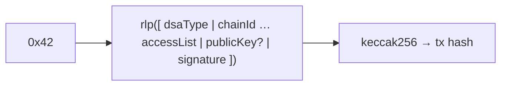
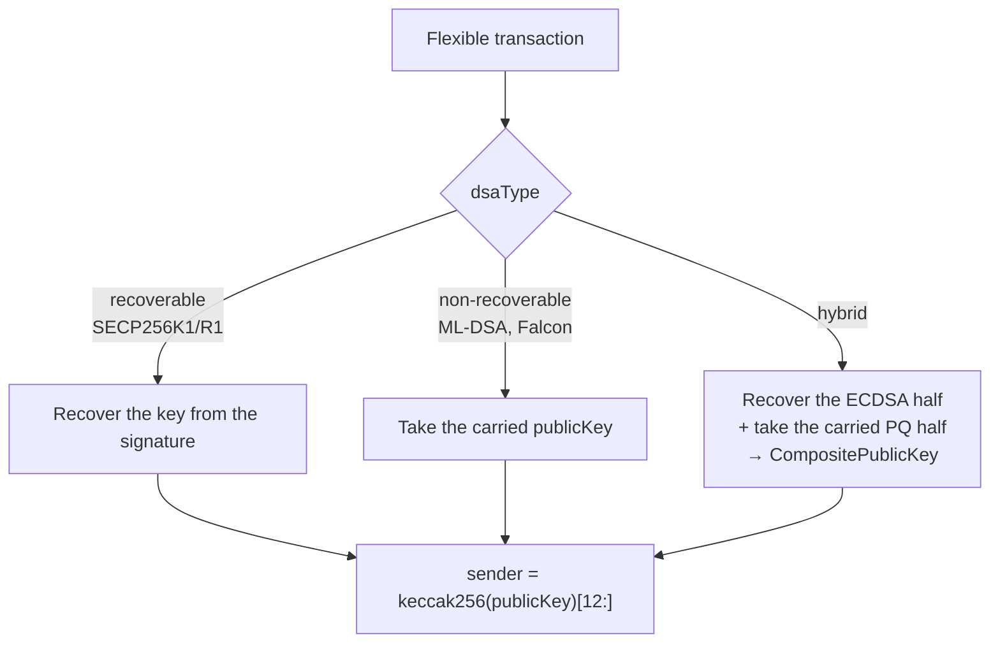

[🏠 Index](README.md) · [⚡ Quick start](00-quick-start.md) · [← Previous: Key management](03-cryptography/key-management.md) · [Next: Consensus →](05-consensus.md)

---

# Transactions

Ethereum transactions do not say which algorithm signed them. Everything assumes ECDSA on secp256k1: the signature is
`(v, r, s)` and the sender is recovered from it. The fork adds **flexible transactions**, which name their DSA, carry a
signature of any length and, when the DSA cannot recover keys, carry the signer's public key.

Standard transaction types (`0x00`–`0x04`) are unchanged and keep working.

## Contents

- [Transaction types](#transaction-types)
- [Wire encoding](#wire-encoding)
- [The public key field](#the-public-key-field)
- [The signature field](#the-signature-field)
- [Signing hash](#signing-hash)
- [Sender derivation](#sender-derivation)
- [Flexible code delegations (EIP-7702)](#flexible-code-delegations-eip-7702)
- [Validation](#validation)
- [Hard-fork activation](#hard-fork-activation)
- [Transaction pool](#transaction-pool)
- [Gas](#gas)
- [Building and signing transactions in Java](#building-and-signing-transactions-in-java)

## Transaction types

Defined in `datatypes/.../TransactionType.java`. Each flexible type mirrors a standard type: the low nibble matches,
and the high nibble `0x4` marks the type as flexible.

| Type | Byte | Mirrors | Access list | EIP-1559 fees | Blobs | Code delegation |
|---|---|---|---|---|---|---|
| `FLEXIBLE_ACCESS_LIST` | `0x41` | `ACCESS_LIST` (`0x01`) | ✓ | — (`gasPrice`) | — | — |
| `FLEXIBLE_EIP1559` | `0x42` | `EIP1559` (`0x02`) | ✓ | ✓ | — | — |
| `FLEXIBLE_BLOB` | `0x43` | `BLOB` (`0x03`) | ✓ | ✓ | ✓ | — |
| `FLEXIBLE_DELEGATE_CODE` | `0x44` | `DELEGATE_CODE` (`0x04`) | ✓ | ✓ | — | ✓ |

There is no flexible counterpart of legacy (Frontier) transactions. `TransactionType.isFlexible()` is true for
`0x41`–`0x44`.

## Wire encoding

Flexible transactions are [EIP-2718](https://eips.ethereum.org/EIPS/eip-2718) typed envelopes:
`type || rlp(fields)`. The transaction hash is `keccak256(type || rlp(fields))`, as for any typed transaction.

Compared with the standard type, the field list changes in three ways:

- `dsaType` is added as the **first** field.
- `yParity, r, s` are replaced by one `signature` byte string.
- An optional `publicKey` is added just before the signature.

| Type | RLP field list |
|---|---|
| `0x41` | `[dsaType, chainId, nonce, gasPrice, gasLimit, to, value, data, accessList, (publicKey), signature]` |
| `0x42` | `[dsaType, chainId, nonce, maxPriorityFeePerGas, maxFeePerGas, gasLimit, to, value, data, accessList, (publicKey), signature]` |
| `0x43` | `[dsaType, chainId, nonce, maxPriorityFeePerGas, maxFeePerGas, gasLimit, to, value, data, accessList, maxFeePerBlobGas, blobVersionedHashes, (publicKey), signature]` |
| `0x44` | `[dsaType, chainId, nonce, maxPriorityFeePerGas, maxFeePerGas, gasLimit, to, value, data, accessList, authorizationList, (publicKey), signature]` |

- **`dsaType`**: the 2-byte big-endian identifier of the DSA, always encoded as a 2-byte RLP string. For example,
  ML-DSA-44 (`0x0030`) is encoded as `0x82 0x00 0x30`. The identifiers are listed in
  [Algorithms](03-cryptography/algorithms.md#identifiers-and-sizes).
- **`(publicKey)`**: present or absent depending on `dsaType`, never as an empty placeholder. See the next section.
- **Network form of `0x43`**: like upstream blob transactions, its pooled form wraps the list with the blobs,
  commitments and proofs: `[[fields…], (wrapperVersion), blobs, commitments, proofs]`.

Encoders and decoders live in `ethereum/core/.../core/encoding/` (`Flexible*TransactionEncoder` and
`Flexible*TransactionDecoder`). They are registered in `TransactionEncoder` and `TransactionDecoder`.



## The public key field

A node can recover the signer's key from an ECDSA signature. A post-quantum signature carries no such information, so
the transaction must carry the key itself. The rule, implemented by `PublicKeyEncoder` and `PublicKeyDecoder`, is to
carry only what cannot be recovered:

| DSA kind | Example | `publicKey` field |
|---|---|---|
| Single recoverable | `SECP256K1`, `SECP256R1` | absent |
| Single non-recoverable | `MLDSA44`, `FALCON512` | the full key (e.g. 1312 bytes for ML-DSA-44) |
| Hybrid, one half recoverable | `SECP256K1-MLDSA44`, `SECP256K1-FALCON512` | only the post-quantum half (1312 or 896 bytes). The ECDSA half is recovered |

The decoder knows from `dsaType` whether a key is expected and how long it must be. It rejects a key of the wrong length,
for example a full composite key where only the post-quantum half is expected.

## The signature field

The signature is always one RLP byte string, never `v, r, s`:

| DSA | Signature bytes |
|---|---|
| `SECP256K1`, `SECP256R1` | 65 bytes: `r (32) ‖ s (32) ‖ recId (1)`, with `recId` 0 or 1 |
| `MLDSA44` / `MLDSA65` / `MLDSA87` | 2420 / 3309 / 4627 bytes |
| `FALCON512` | variable length (about 650 bytes, 752 at most) |
| `SECP256K1-MLDSA44` | 2485 bytes: ECDSA (65) ‖ ML-DSA-44 (2420) |
| `SECP256K1-FALCON512` | variable length: ECDSA (65) ‖ Falcon-512 |

[Hybrid signatures](03-cryptography/hybrid-signatures.md) explains how the two halves of a hybrid signature are built.

## Signing hash

The signer signs:

```
signingHash = keccak256( type || rlp([dsaType, <all fields except signature>, (publicKey)]) )
```

The signing hash covers **`dsaType`** and, when one is carried, the **`publicKey`**. This means:

- the algorithm cannot be swapped after signing (no algorithm-substitution attack);
- the carried key cannot be replaced by another key.

Recovered key material is not part of the hash; it is already bound by the signature itself. The preimages are built
in `Transaction.java` (`flexibleEip1559Preimage`, `flexibleAccessListPreimage`, `flexibleBlobPreimage`,
`flexibleCodeDelegationPreimage`).

## Sender derivation



- `PublicKeyHandler.resolvePublicKey` resolves the key, and `Transaction.getSender()` derives the address.
- For a hybrid, the address is the hash of the **concatenated** key `ecdsaKey ‖ pqKey`. The address therefore commits
  to both keys, and a hybrid account is a different account from the ECDSA-only account with the same ECDSA key.
- Senders are cached by transaction hash. `Transaction.resolvableSender()` returns an empty result instead of throwing
  when the key cannot be resolved, so such a transaction is rejected with `INVALID_SIGNATURE` instead of causing an
  internal error.

## Flexible code delegations (EIP-7702)

[EIP-7702](https://eips.ethereum.org/EIPS/eip-7702) authorizations ("code delegations") are themselves signed by the
authorizing account. A post-quantum account must therefore be able to sign them with its own DSA. `CodeDelegationType`
has two kinds:

| Kind | Type byte | Wire form inside `authorizationList` |
|---|---|---|
| `LEGACY` | `0xf8` (internal marker) | an RLP list `[chainId, address, nonce, yParity, r, s]`, exactly as upstream |
| `FLEXIBLE` | `0x01` | an RLP **byte string**: `0x01 ‖ rlp([dsaType, chainId, address, nonce, (publicKey), signature])` |

- The decoder treats a list as legacy and a byte string as typed.
- Both kinds can be mixed in one `authorizationList`, and both `0x04` and `0x44` transactions accept both kinds.
- A flexible delegation signs `keccak256(0x05 ‖ 0x01 ‖ rlp([0x01, dsaType, chainId, address, nonce, (publicKey)]))`.
- The `publicKey` rule is the same as for transactions.
- The authority is `keccak256(resolvedPublicKey)[12:]`.

> **Compatibility note:** changing the flexible delegation signing layout would invalidate every delegation already
> signed. The layout is defined in `CodeDelegation.computeSenderRecoveryHash`.

## Validation

`MainnetTransactionValidator.validateTransactionSignature` checks every transaction, in this order:

1. **Structure.** `signature.isValid(SignatureValidationContext)`:
   - ECDSA: low-`s` against its own curve (malleability protection);
   - ML-DSA: non-empty;
   - Falcon: non-empty and not longer than the maximum;
   - hybrid: both halves valid.
2. **Sender.** The signer's key must be resolvable (see [Sender derivation](#sender-derivation)).
3. **Signature.**
   - Recoverable DSAs need no further check, because recovery has already authenticated the signer.
   - Every other DSA runs `dsa.verify(signingHash, signature, resolvedPublicKey)`. For a hybrid, both halves must verify.
4. **DSA policy.** `dsaType` must be one of the node's `--accounts-supported-dsas`. This check runs earlier, while the
   transaction is decoded.

Every failure is reported as `INVALID_SIGNATURE`. A DSA that is not enabled is rejected with:

```text
DSA type MLDSA44 (0x0030) is not enabled for accounts on this node
```

For code delegations, `validateCodeDelegation` verifies the signature against the **resolved** signer key. For a hybrid,
that is the recovered ECDSA half plus the carried post-quantum half. Its errors include
`Invalid code delegation signature` and `Code delegation signer key could not be resolved`.

### Where signatures are checked

| Stage | Check |
|---|---|
| `eth_sendRawTransaction` / gossip → transaction pool | full validation (`TransactionPool`) |
| Block processing (proposal validation, import, sync) | signature validation again (`MainnetTransactionProcessor`) |

Checking signatures during block processing is essential. Without it, a malicious block proposer could include a
transaction that carries a victim's ML-DSA public key with an arbitrary signature, and peers would execute it as the
victim. To keep this affordable, successful verifications are cached by transaction hash (up to 100 000 entries), so a
transaction is verified once even though it passes through pool admission, block building, proposal validation and
import. [Metrics and performance](12-metrics-and-performance.md) discusses the cost.

## Hard-fork activation

The flexible types are added to the accepted transaction types in the **Prague** protocol specification
(`MainnetProtocolSpecs.pragueDefinition`). Use a genesis with `pragueTime: 0`, as the companion
[besu-qbft](11-usage/running-a-network.md) network does.

> ⚠️ **Osaka and later forks:** the Osaka specification (and the BPO and Amsterdam specifications built on it)
> redefines the accepted types and does **not** currently include the flexible types. Do not schedule `osakaTime` on a
> network that uses flexible transactions.

When a type is not accepted, the transaction is rejected with
`Transaction type … is invalid, accepted transaction types are …`. Under Prague, `FLEXIBLE_BLOB` accepts only
KZG-proof blobs, like `BLOB`.

## Transaction pool

`PendingTransaction.computeMemorySize` accounts for the extra fields of flexible transactions, so that the pool's memory
limits stay meaningful when signatures are several kilobytes long:

```
size(flexible) = size(base type) + 40 (dsaType) + [40 + |publicKey|] + 96 + |signature|
```

Each flexible code delegation adds its key and signature on top of the base entry size. All other pool behaviour
(ordering, replacement, eviction) is upstream behaviour.

## Gas

**The fork does not add gas charges for signature verification**, and intrinsic gas follows upstream rules. Keys and
signatures are not part of the transaction payload (`data`), so they do not add calldata gas either. A flexible transfer
costs 21 000 gas, like a standard one, even though its verification is more expensive and the transaction is much
larger.

The [DSA microbenchmark](12-metrics-and-performance.md#dsa-microbenchmark-verification-cost-in-gas) measures what
verification *would* cost in gas, as input for a future pricing decision.

## Building and signing transactions in Java

`Transaction.Builder#signAndBuild` and `CodeDelegation.Builder#signAndBuild` sign with the algorithm of the `dsaType`
that was set on the builder, which must be enabled on the node. If no public key was set, the builder fills in the part
that must be carried (see [The public key field](#the-public-key-field)) before signing, because the signature covers it.

```java
Transaction tx = Transaction.builder()
    .type(TransactionType.FLEXIBLE_EIP1559)   // flexible types are never inferred
    .dsaType(DSAParametersSet.SECP256K1MLDSA44.getId())
    .chainId(BigInteger.valueOf(381660666))
    .nonce(0)
    .maxPriorityFeePerGas(Wei.ZERO)
    .maxFeePerGas(Wei.ZERO)
    .gasLimit(21_000)
    .to(Address.fromHexString("0xf17f52151EbEF6C7334FAD080c5704D77216b732"))
    .value(Wei.ZERO)
    .payload(Bytes.EMPTY)
    .signAndBuild(hybridKeyPair);
```

Without a `dsaType`, signing behaves as in upstream Besu (secp256k1). Outside Java, use the
[flex wallet](11-usage/sending-transactions.md) or its source as a reference implementation.

---

[🏠 Index](README.md) · [⚡ Quick start](00-quick-start.md) · [← Previous: Key management](03-cryptography/key-management.md) · [Next: Consensus →](05-consensus.md)
