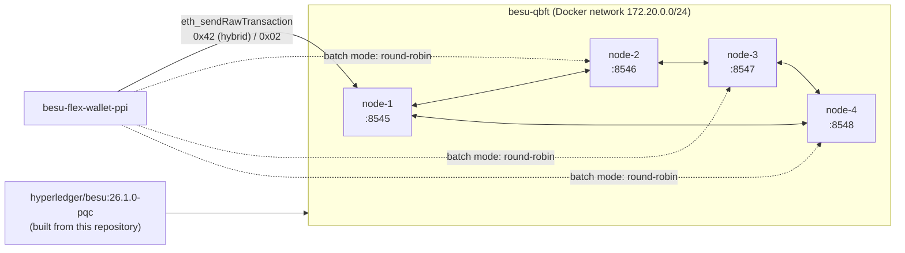

[🏠 Index](../README.md) · [⚡ Quick start](../00-quick-start.md) · [← Previous: Configuration](../10-configuration.md) · [Next: Running a network →](running-a-network.md)

---

# Usage

Two companion projects are published together with this fork. They are the easiest way to run a post-quantum network and
send transactions to it.

| Project | What it does | Page |
|---|---|---|
| [**besu-qbft**](https://github.com/venturusbr/besu-qbft) | Bash scripts and Docker Compose files that generate a genesis and node keys with any node DSA, then start an N-validator QBFT network | [Running a network](running-a-network.md) |
| [**besu-flex-wallet-ppi**](https://github.com/venturusbr/besu-flex-wallet-ppi) | A Java command-line wallet that generates keys, signs `FlexibleEIP1559` (hybrid post-quantum) or `EIP1559` transactions and sends them one at a time or in parallel batches | [Sending transactions](sending-transactions.md) |

## Typical workflow

1. Build the image `hyperledger/besu:26.1.0-pqc` ([Installation](../09-installation.md#building-the-docker-image)).
2. Start a network with the node DSA you want to test ([Running a network](running-a-network.md)).
3. Send single transactions or batches with the account DSA you want to test
   ([Sending transactions](sending-transactions.md)).
4. Inspect the results in the node logs, over JSON-RPC, and in the
   [signature metrics](../12-metrics-and-performance.md).

The [⚡ Quick start](../00-quick-start.md) runs through this workflow once with default settings.

---

[🏠 Index](../README.md) · [⚡ Quick start](../00-quick-start.md) · [← Previous: Configuration](../10-configuration.md) · [Next: Running a network →](running-a-network.md)
