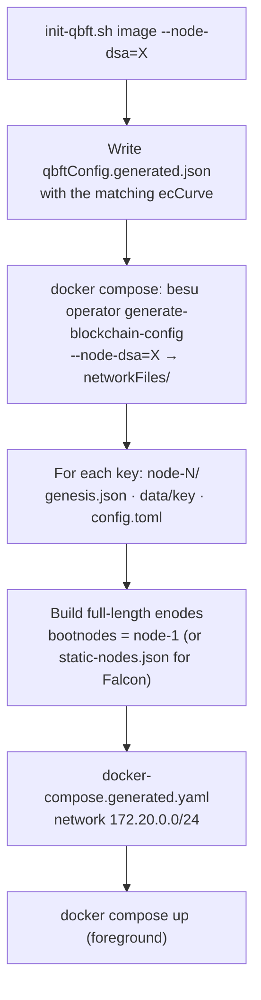

[🏠 Index](../README.md) · [⚡ Quick start](../00-quick-start.md) · [↑ Usage](README.md) · [← Previous: Usage](README.md) · [Next: Sending transactions →](sending-transactions.md)

---

# Running a network

## Contents

- [Ways to start a network](#ways-to-start-a-network)
- [besu-qbft](#besu-qbft)
  - [Prerequisites](#prerequisites)
  - [Start](#start)
  - [Choosing the node DSA](#choosing-the-node-dsa)
  - [Number of validators](#number-of-validators)
  - [What the script does](#what-the-script-does)
  - [Ports](#ports)
  - [Network parameters](#network-parameters)
  - [Checking the network](#checking-the-network)
  - [Stopping and cleaning up](#stopping-and-cleaning-up)
  - [Falcon node keys (experimental)](#falcon-node-keys-experimental)
- [Manual setup](#manual-setup)
- [Other consensus protocols](#other-consensus-protocols)

## Ways to start a network

| Way | Use it for |
|---|---|
| **besu-qbft with `SECP256K1`** (default) | A classical validator set. Post-quantum signatures are used only by accounts (flexible transactions) |
| **besu-qbft with `SECP256K1-MLDSA44`** | A fully post-quantum-authenticated network: hybrid validators, consensus messages, seals and discovery |
| **besu-qbft with `SECP256R1`** | A P-256 network (`ecCurve: secp256r1`), for HSM- or enclave-friendly keys |
| **besu-qbft with `SECP256K1-FALCON512`** | Experimental: Falcon validators with static peering |
| **Manual setup** | Custom topologies, bare-metal nodes, IBFT 2.0 or Clique |
| **Single node** (`--network=dev`) | Checking the build and the RPC API only (see [Installation](../09-installation.md#verifying-the-installation)) |

## besu-qbft

```bash
git clone https://github.com/venturusbr/besu-qbft.git
```

### Prerequisites

- Docker with Compose v2 (`docker compose`).
- Bash. Use Linux, macOS, or WSL 2 or Git Bash on Windows. It was tested on Ubuntu 24.04 and on Windows 11 with Rancher
  Desktop.
- The Besu PQC image, `hyperledger/besu:26.1.0-pqc` by default
  ([Installation](../09-installation.md#building-the-docker-image)).

### Start

```bash
cd besu-qbft && chmod +x init-qbft.sh
```

```bash
./init-qbft.sh hyperledger/besu:26.1.0-pqc
```

Usage: `./init-qbft.sh <besu-image> [--node-dsa=<DSA>]`. Run `./init-qbft.sh --help` to print the usage. The script
runs in the foreground and streams the logs of every node, prefixed by its container name (`node-1  | …`).

### Choosing the node DSA

```bash
./init-qbft.sh hyperledger/besu:26.1.0-pqc --node-dsa=SECP256K1-MLDSA44
```

| `--node-dsa` | Public key (hex characters in the enode) | Genesis `ecCurve` | Discovery |
|---|---|---|---|
| `SECP256K1` (default) | 128 | `secp256k1` | bootnodes |
| `SECP256R1` | 128 | `secp256r1` | bootnodes |
| `SECP256K1-MLDSA44` | 2752 | `secp256k1` | bootnodes |
| `SECP256K1-FALCON512` *(experimental)* | 1920 | `secp256k1` | disabled, static nodes |

The script writes the matching `ecCurve` into a generated copy of the genesis configuration
(`genesis-generator/qbftConfig.generated.json`), so `qbftConfig.json` stays unchanged. All nodes use the same DSA. The
first line of output confirms the choice:

```text
Using image hyperledger/besu:26.1.0-pqc with node DSA SECP256K1-MLDSA44 (ecCurve secp256k1)
```

### Number of validators

Set `blockchain.nodes.count` in `genesis-generator/qbftConfig.json` (4 by default). Node *N* gets:

| | Value |
|---|---|
| Container | `node-N` |
| IP address | `172.20.0.(N+1)` |
| JSON-RPC | `http://localhost:(8544+N)`, published on the host |
| P2P port | `30302+N`, internal to the Docker network |
| Metrics port | `9544+N`, internal to the Docker network |

### What the script does



Every run deletes the previous `node-*` directories and containers. **Every run starts a new chain from block 0, with
new keys.**

### Ports

Only the JSON-RPC ports are published on the host:

| Node | JSON-RPC URL |
|---|---|
| node-1 | `http://localhost:8545` |
| node-2 | `http://localhost:8546` |
| node-3 | `http://localhost:8547` |
| node-4 | `http://localhost:8548` |

### Network parameters

| Parameter | Value |
|---|---|
| Consensus | QBFT, 2-second blocks, epoch 30 000, request timeout 10 s |
| Hard fork | `pragueTime: 0` (flexible transactions enabled) |
| Chain ID | `381660666` |
| Block gas limit | 50 000 000 |
| Gas price | free: `zeroBaseFee: true` and `min-gas-price=0` |
| Prefunded accounts | none (transactions with value 0 and fee 0 need no funds) |
| Account DSAs | `SECP256K1, SECP256R1, SECP256K1-MLDSA44, SECP256K1-FALCON512` |
| RPC APIs | `ETH, NET, QBFT, VNT` |
| Transaction pool | `sequenced`, 10 000 transactions |

To accept other account DSAs (for example pure `MLDSA44`), edit `accounts-supported-dsas` in
`genesis-generator/config.toml` before starting.

### Checking the network

Block production, every 2 seconds:

```text
node-1  | … | INFO  | QbftBesuControllerBuilder | Produced empty block #12 / 0 tx / 0 pending / 0 (0.0%) gas / (0x…)
node-2  | … | INFO  | QbftBesuControllerBuilder | Imported empty block #12 / 0 tx / 0 pending / 0 (0.0%) gas / (0x…)
```

Only blocks that contain transactions:

```bash
docker logs -f node-1 2>&1 | grep -E "(Produced|Imported) block #[0-9]+ / [1-9]"
```

Containers and ports:

```bash
docker ps --format "table {{.Names}}\t{{.Status}}\t{{.Ports}}"
```

Over JSON-RPC:

```bash
curl -s -X POST -H "Content-Type: application/json" --data '{"jsonrpc":"2.0","method":"qbft_getValidatorsByBlockNumber","params":["latest"],"id":1}' http://localhost:8545
```

```bash
curl -s -X POST -H "Content-Type: application/json" --data '{"jsonrpc":"2.0","method":"vnt_getAccountsSupportedDSAs","params":[],"id":1}' http://localhost:8545
```

```bash
curl -s -X POST -H "Content-Type: application/json" --data '{"jsonrpc":"2.0","method":"net_peerCount","params":[],"id":1}' http://localhost:8545
```

With `SECP256K1-MLDSA44`, the validator addresses are the hashes of the 1376-byte hybrid keys, and `net_peerCount`
should report `0x3` on a four-node network.

### Stopping and cleaning up

Press **Ctrl+C** in the terminal that runs the script. This stops the containers but keeps them. To remove the
containers and the network:

```bash
docker compose -f docker-compose.generated.yaml down
```

If containers are left over from an interrupted run:

```bash
docker rm -f node-1 node-2 node-3 node-4
```

### Falcon node keys (experimental)

```bash
./init-qbft.sh hyperledger/besu:26.1.0-pqc --node-dsa=SECP256K1-FALCON512
```

The script prints a warning, sets `discovery-enabled=false` and connects the nodes through `static-nodes.json`, because
discovery does not support Falcon node keys yet (see [Networking](../06-networking.md#falcon-node-keys)).

## Manual setup

To run nodes outside besu-qbft, for example on several hosts:

1. Write a network configuration (`genesis` with `pragueTime: 0`, and `blockchain.nodes.count`), then generate keys and
   the genesis:

   ```bash
   besu operator generate-blockchain-config --config-file=qbftConfig.json --to=networkFiles --private-key-file-name=key --node-dsa=SECP256K1-MLDSA44
   ```

2. Give each node its `key`, the shared `genesis.json`, and a `config.toml` like
   [the example](../10-configuration.md#example-configtoml), with its own `p2p-host` and ports.
3. Build each node's enode from its `key.pub`, then set `bootnodes` on the other nodes, or use `static-nodes.json`.
4. Start every node:

   ```bash
   besu --config-file=config.toml
   ```

## Other consensus protocols

- **IBFT 2.0:** the same procedure, with an `ibft2` section in the network configuration. The fork's IBFT 2.0 support is
  the same as for QBFT (see [Consensus](../05-consensus.md#support-matrix)).
- **Clique:** create the genesis `extraData` with the signers' addresses (derived from their full public keys) and run
  the nodes with the same `--node-dsa`. The genesis block can keep the classic 65-byte zero seal.

---

[🏠 Index](../README.md) · [⚡ Quick start](../00-quick-start.md) · [↑ Usage](README.md) · [← Previous: Usage](README.md) · [Next: Sending transactions →](sending-transactions.md)
